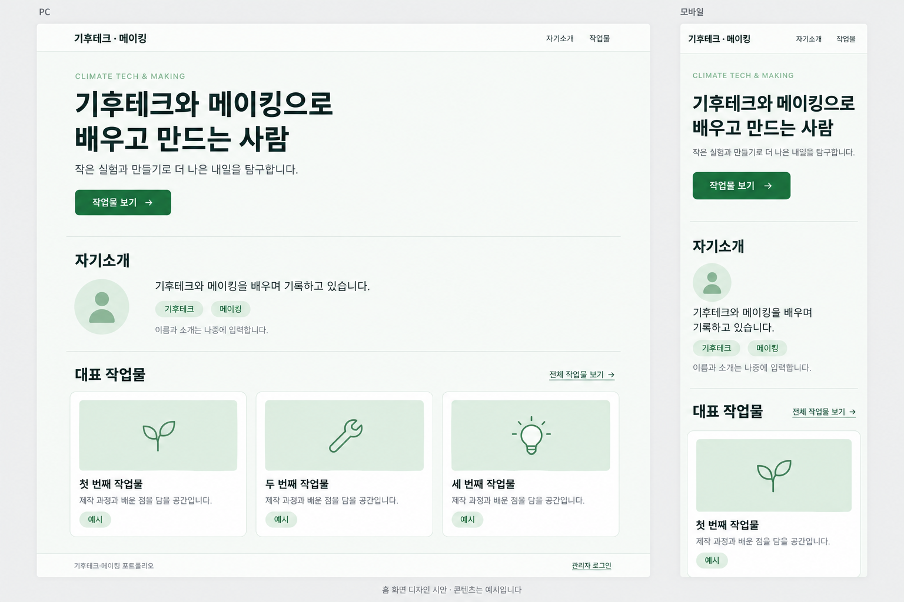

# 기후테크·메이킹 포트폴리오

기후테크 과정 제출용 개인 포트폴리오의 기획 문서, 디자인 시안, 재사용 UI 컴포넌트입니다.

## 구성

- [제품 요구사항](prd.md)
- [디자인 가이드](design.md)
- [PC·모바일 화면 시안](home-preview.png)
- [이미지 생성 프롬프트](home-preview-prompt.md)
- [컴포넌트 사용 방법](ui/README.md)
- [컴포넌트 미리보기 소스](ui/index.html)

## 실행

저장소를 내려받은 후 `ui/index.html`을 브라우저로 열어주세요. 별도 설치나 빌드가 필요하지 않습니다. GitHub 파일 화면에서는 HTML이 실행되지 않습니다.

## 현재 구현 범위

초록색 테마의 버튼, 배지, 카드, 입력란, 알림, 빈 화면, 모달, 헤더, 이미지 선택 컴포넌트를 파일별로 제공합니다. 반응형 화면과 한글 주석을 적용했습니다.

현재는 UI 미리보기 단계이며 로그인, 서버 업로드, 영구 저장은 아직 연결하지 않았습니다. 소개와 작업물은 예시입니다.

